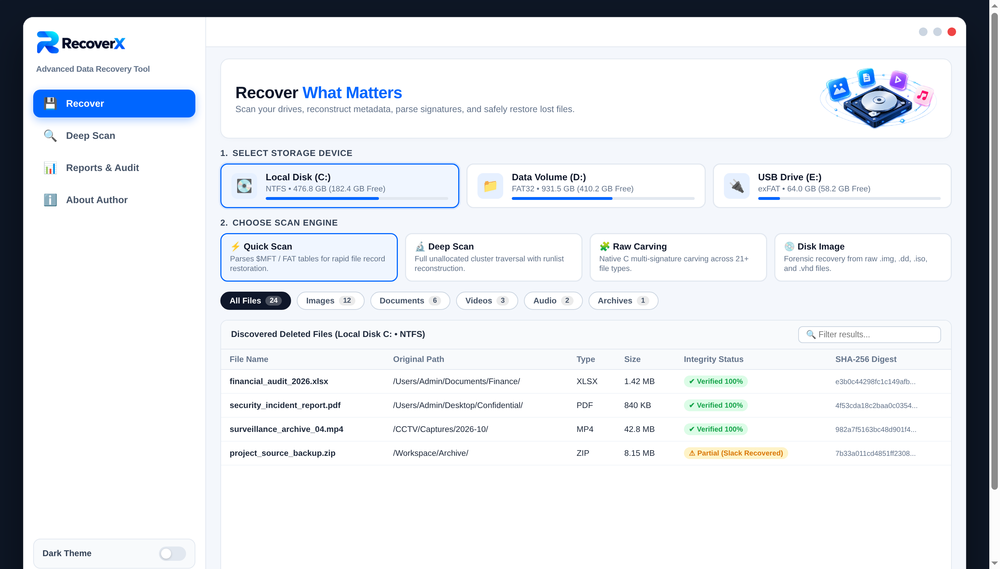

<p align="center">
  
</p>

<p align="center">
  <strong>Strictly read-only, forensic-grade data recovery suite for Windows.</strong><br>
  <em>Reconstructs deleted files from NTFS, FAT32, exFAT, and EXT4 partitions via deep metadata parsing &amp; raw signature carving.</em>
</p>

<p align="center">
  
  
  
  
  
  
  
</p>

---

## ✨ Interface Preview

### Desktop Application Workspace


## 🚀 Key Features

### 1. Multi-File-System Metadata Parsing
Parses raw on-disk binary filesystem records directly to recover deleted files, recreate complete directory hierarchies, restore timestamps, and reconstruct fragmented cluster runlists:

| File System | Core Module | Supported On-Disk Data Structures | Recovery Engine Capabilities |
| :--- | :--- | :--- | :--- |
| **NTFS** | `filesystems/ntfs.py` | Boot Sector BPB, `$MFT` records, Update Sequence Array (USA) fixups | Resident (`$DATA` in-record) & non-resident variable-length runlists, `$STANDARD_INFORMATION` (`0x10`), `$FILE_NAME` (`0x30`), parent-pointer directory tree reconstruction |
| **FAT32** | `filesystems/fat32.py` | BIOS Parameter Block (BPB), File Allocation Tables (FAT1/FAT2) | Recursive directory cluster traversal, VFAT Long File Name (`0x0F`) sequence reconstruction across deleted (`0xE5`) directory entries |
| **exFAT** | `filesystems/exfat.py` | Main Boot Sector, Cluster Heap allocation offset bitmap | Deleted Directory Entry Sets (`0x05` Primary File Record, `0x40` Stream Extension with `NoFatChain` flag, and `0x41` UTF-16LE File Name entries) |
| **EXT4** | `filesystems/ext4.py` | Superblock, Block Group Descriptors, Inode tables | Extent tree (`0xF30A` magic) resolution, direct/indirect block resolution, unlinked deleted inode traversal for Linux & Android storage |

### 2. Deep File Carving & Structural Validators
Scans unallocated sectors using a chunked, bounded-memory streaming carver (`carving/carver.py`) paired with an optional sliding-window **Native C Accelerator** (`carving/fast_scanner.c`):

| File Category | Supported File Types | Structural Integrity & Magic-Byte Verification |
| :--- | :--- | :--- |
| **Images** | `JPG`, `PNG`, `GIF`, `BMP`, `TIFF`, `WebP` | PNG chunk CRC32 & `IEND` footer check, JPEG `SOF`/`SOS`/`EOI` boundary markers, RIFF WebP container validation |
| **Documents** | `PDF`, `DOCX`, `XLSX`, `PPTX`, `TXT` | PDF cross-reference (`xref`) & `%%EOF` parsing, ZIP/OOXML End of Central Directory (`EOCD`) validation |
| **Videos** | `MP4`, `MOV`, `AVI`, `MKV` | ISO BMFF (`ftyp`/`moov`/`mdat`) atom box traversal, RIFF AVI stream headers, Matroska EBML structure checks |
| **Audio** | `MP3`, `WAV`, `FLAC` | ID3v2 metadata & MPEG sync frames, RIFF `WAVE` chunk sizing, native `fLaC` streaminfo header checks |
| **Archives** | `ZIP`, `7Z`, `RAR`, `GZIP` | Central Directory table CRC verification, 7z signature header checks, RAR v4/v5 block parsing |

### 3. Strictly Read-Only Forensic Safety & Device Guards
- **Hardware-Aligned Read-Only I/O**: `ReadOnlyDeviceReader` opens all storage devices and forensic images with `os.O_RDONLY` using `4096`-byte sector-aligned buffers. Any invocation of `.write()` or `.truncate()` raises an immediate `PermissionError`.
- **Physical Disk Guardrail**: Opening a raw physical drive (`DeviceType.PHYSICAL_DISK`) requires explicit user confirmation (`PhysicalDiskConfirmationRequired`) before accessing sectors.
- **Same-Volume Overwrite Protection**: Automatically detects whether the selected destination restore directory resides on the same volume being scanned, blocking or warning before recovery to prevent overwriting unallocated clusters.
- **Dynamic Hotplug Discovery**: Automatically detects mounted volumes, removable USB flash storage, and external drives without pre-populating phantom devices.

### 4. Non-Executing File Preview & Forensic Hex Inspector
- **Safe In-App Preview (`preview/handler.py`)**: Previews recovered photos, multi-page PDFs, ZIP archive hierarchies, video thumbnails, and text without executing embedded macros or malicious payloads.
- **Forensic Hex Inspector (`ui/views.py`)**: Inspects raw binary sector offsets, hex dumps, and ASCII translations alongside recovery confidence scores (`Verified 100%`, `Partial`, `Corrupt`).
- **Modern PySide6 Desktop Interface (`ui/`)**: Built with a responsive **Light** (`#F3F8FD`) and **Dark** (`#0B121E`) theme switch, an animated 3D Neon Orbit hero platter, and instant search filtering.

### 5. Audit History & Forensic Reports
- **SQLite Audit Persistence (`storage/database.py`)**: Stores scan sessions, discovered files, timestamps, and recovery events in a local SQLite database.
- **Multi-Format Forensic Reports (`reports/exporter.py`)**: Exports verifiable recovery manifests and **SHA-256 file hashes** into styled **HTML**, **JSON**, and **CSV** reports.

---

## 📂 Project Structure

```text
RecoverX/
├── main.py                      # GUI launcher, headless CLI scanner, and --self-test runner
├── run_recoverx.bat             # One-click Windows launcher (auto-requests Admin & sets up .venv)
├── build_exe.bat                # PyInstaller Windows .exe packaging script (with UAC admin manifest)
├── build_nuitka.bat             # Nuitka standalone single-file Windows .exe compiler script
├── requirements.txt             # Python dependencies (PySide6, Pillow, pypdf, pypdfium2, pyinstaller)
├── .gitignore                   # Git ignore rules for Python, C binaries, and test artifacts
├── LICENSE                      # MIT License
├── README.md                    # Project documentation
├── assets/                      # Official Ribbon Wordmarks, UI icons, and 3D neon orbit artwork
├── docs/
│   └── screenshots/             # Desktop UI & author profile preview screenshots
├── sample_images/
│   └── FIXTURE_HASHES.json      # Reference SHA-256 fixture hashes for deterministic verification
├── devices/
│   ├── discovery.py             # Physical drive, partition, and disk-image hotplug discovery
│   └── reader.py                # Strictly read-only 4 KB sector-aligned block reader
├── filesystems/
│   ├── base.py                  # Abstract filesystem parser interface & entry models
│   ├── ntfs.py                  # NTFS $MFT record, USA fixup, and signed cluster runlist parser
│   ├── fat32.py                 # FAT32 BPB, FAT chains, and VFAT 0xE5 deleted entry parser
│   ├── exfat.py                 # exFAT Boot Sector, Cluster Heap, and 0x05/0x40/0x41 entry parser
│   └── ext4.py                  # EXT4 Superblock, Inode table, and extent tree (0xF30A) parser
├── carving/
│   ├── fast_scanner.c           # Native C sliding-window multi-signature scanner (optional accelerator)
│   ├── signatures.py            # Magic-byte header/footer registry across 21+ file types
│   ├── validators.py            # Format-specific structural & CRC validators
│   └── carver.py                # Bounded-memory streaming file carver
├── recovery/
│   └── engine.py                # Scan orchestrator (Quick, Deep, Carve, Image) & safe file restorer
├── preview/
│   └── handler.py               # Safe non-executing preview handler (Image, PDF, ZIP, Hex)
├── storage/
│   └── database.py              # Thread-safe SQLite session, finding, and recovery log database
├── reports/
│   └── exporter.py              # HTML, JSON, and CSV forensic report exporter with SHA-256 digests
├── ui/
│   ├── main_window.py           # Main 1536x1024 PySide6 desktop window & navigation
│   ├── theme.py                 # Dark (#0B121E) and Light (#F3F8FD) palettes & QSS styles
│   ├── icons.py                 # Vector QPainter icons & official logo loader
│   ├── widgets.py               # 3D Neon Orbit hero, Drive cards, and Scan Mode selectors
│   ├── views.py                 # Hex Inspector, Reports Center, and Author Profile views
│   └── workers.py               # Background QThread workers with progress & cancellation tokens
└── tests/
    ├── fixture_generator.py     # Deterministic synthetic test disk image generator
    └── test_recovery_suite.py   # 11-part automated unit & SHA-256 recovery test suite
```

---

## ⚙️ Requirements & System Prerequisites

- **Operating System**: Windows 10 or Windows 11 (64-bit recommended; CLI & test runner also run on Linux/macOS)
- **Python**: Python 3.10+
- **Core Dependencies**: `PySide6`, `Pillow`, `pypdf`, `pypdfium2`, `pyinstaller`
- **User Privileges**: Standard user permissions to scan disk image files (`.img`, `.iso`, `.dd`, `.vhd`). Administrator privileges are only required on Windows when scanning physical drives (`\\.\PhysicalDriveN`) or raw volume handles (`\\.\C:`).

---

## 🛠️ Installation & Quick Start

1. **Clone the repository**:
   ```bash
   git clone https://github.com/ishaqsec/RecoverX.git
   cd RecoverX
   ```

2. **Configure virtual environment & launch**:
   ```bat
   python -m venv .venv
   .venv\Scripts\activate
   pip install -r requirements.txt
   python main.py
   ```
   *(Or simply double-click `run_recoverx.bat` on Windows to set up the environment and launch automatically.)*

3. **Optional — Compile Native C Acceleration**:
   - **Windows (MinGW / GCC)**:
     ```bat
     gcc -O3 -shared carving\fast_scanner.c -o carving\fast_scanner.dll
     ```
   - **Linux / macOS**:
     ```bash
     gcc -O3 -shared -fPIC carving/fast_scanner.c -o carving/libfast_scanner.so
     ```

4. **Optional — Build Standalone Executable (`RecoverX.exe`)**:
   - **PyInstaller**: Run `build_exe.bat` (generates `dist\RecoverX\RecoverX.exe` with UAC elevation manifest).
   - **Nuitka**: Run `build_nuitka.bat` (generates single-file standalone `dist\RecoverX.exe`).

---

## 🧪 Automated Testing & Headless CLI

Run the built-in 11-part test suite (builds disposable NTFS, FAT32, exFAT, and EXT4 disk images with known files and verifies exact SHA-256 recovery):

```bash
python main.py --self-test
# or via unittest:
python -m unittest discover -s tests -v
```

Execute a headless CLI deep scan and export an audit report directly from any disk image:

```bash
python main.py --scan path/to/disk.img --mode deep --recover-to ./restored_out --export-report ./report.json
```

---

## ⚠️ Important Forensic Disclaimers

- **Overwritten Data**: Once unallocated clusters are overwritten with new data by the operating system, original file contents cannot be recovered.
- **SSD TRIM / Deallocation**: On solid-state drives with TRIM enabled, deleted file blocks may be zeroed out almost immediately by the SSD controller.
- **Encrypted Media**: BitLocker (`-FVE-FS-`) and LUKS volumes are detected and reported as encrypted; RecoverX operates on decrypted volumes or unencrypted disk images.
- **Safe Restoration**: Never save recovered files to the same partition being scanned, as new file writes can overwrite unrecovered clusters.

---

## 👤 Author

**Muhammad Ishaq**
- **GitHub**: [@ishaqsec](https://github.com/ishaqsec)
- **LinkedIn**: [Muhammad Ishaq](https://www.linkedin.com/in/muhammad-ishaq-4b3010390/)
- **Email**: [reachout2ishaq@gmail.com](https://mail.google.com/mail/?view=cm&fs=1&to=reachout2ishaq@gmail.com)
- **Version**: `v1.0.0`
- **License**: [MIT License](LICENSE)
